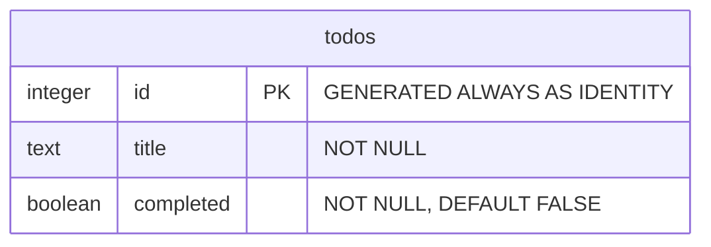

**ER-diagram för todo-projektet**

Databasen `todo_db` använder PostgreSQL. Tabellen `todos` lagrar en rad per uppgift. Diagrammet beskriver den nuvarande tabellen, kontrollerad mot både `db_setup.py` och den lokala databasen.

| Kolumn | Datatyp | Regel | Betydelse |
|---|---|---|---|
| `id` | `INTEGER` | Primärnyckel, automatiskt genererad identitet, obligatorisk. | Identifierar uppgiften unikt. |
| `title` | `TEXT` | `NOT NULL`. | Uppgiftens titel. |
| `completed` | `BOOLEAN` | `NOT NULL`, standardvärde `FALSE`. | Anger om uppgiften är klar. |

Datamodellen består av en tabell. När en uppgift skapas genererar PostgreSQL dess id och använder `FALSE` för färdigstatus om inget annat anges.

API:t har dessutom titelvalidering i `schemas.py`. Den tar bort omgivande blanksteg och avvisar tomma titlar samt NUL-tecken. Dessa regler kompletterar databasens `NOT NULL`-regel.

Tabellen definieras i [db_setup.py](../db_setup.py), och SQL-frågorna finns i [db.py](../db.py).
